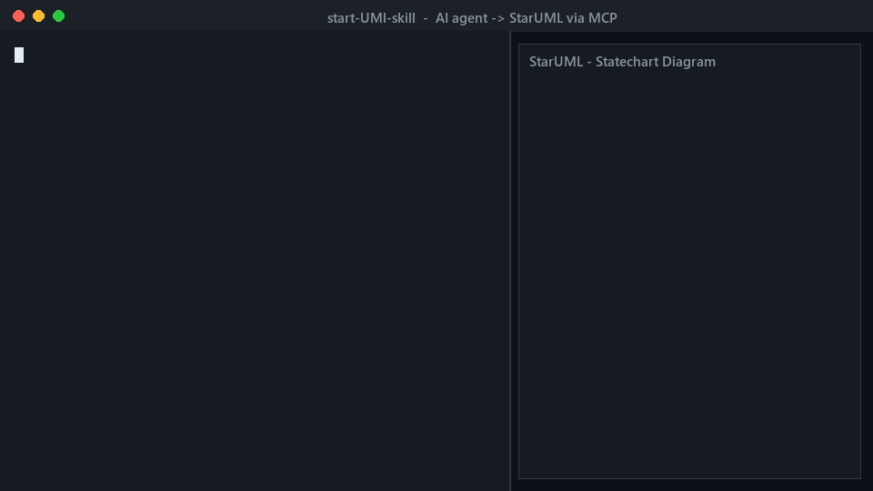

# start-UMl-skill

> **A drop-in skill that teaches any AI agent (opencode, Claude Code, Cursor, Codex…) how to drive StarUML through MCP — the Mermaid dialect, the parser traps, the failure-safety protocol, and the verification workflow.**



## One-command install

**Linux / macOS / WSL:**
```bash
curl -fsSL https://raw.githubusercontent.com/GUURUUU/start-UMl-skill/main/install.sh | bash
```

**Windows (PowerShell):**
```powershell
irm https://raw.githubusercontent.com/GUURUUU/start-UMl-skill/main/install.ps1 | iex
```

Both scripts download `SKILL.md` into your agent's skills folder (`~/.config/opencode/skills/staruml/` by default, or `--target claude` / `--target agents`). Restart your agent, open StarUML, and start generating UML diagrams by chat.

> The full MCP plumbing (StarUML API server, `staruml-mcp` server, ports 58321/58322/58323) is documented step by step in **[docs/MANUAL_SETUP.md](docs/MANUAL_SETUP.md)**.

## Why

AI agents *can* call `generate_diagram` on StarUML's MCP server — but they fail constantly, because StarUML accepts a **restricted Mermaid dialect** that standard Mermaid docs don't describe:

| Trap | Standard Mermaid | StarUML reality |
| ---- | ---------------- | --------------- |
| `: e1 : créé` (two colons in a label) | ✅ valid | ❌ **hard fail** — parser splits on every colon |
| `Créé`, `Hors Prêt` (accents) | ✅ valid | ❌ corrupted in transit → invalid identifiers |
| `direction LR` / YAML frontmatter | ✅ valid | ❌ fails |
| `activityDiagram` | separate type | ❌ not supported — use `flowchart` |
| Composite states, multiple regions | documented | ✅ works — but only *after* a flat diagram succeeds |

This skill encodes all of it, plus a verification workflow (`generate → map IDs → image-check`) and a failure-safety protocol (one failure → stop and report, never retry-loop).

## What's inside

| Path | Purpose |
| ---- | ------- |
| `SKILL.md` | The skill itself — 11 sections: tool contract, supported keywords, state-diagram hard rules, empirical parser findings, flowchart recipes, failure-safety protocol, verification workflow, housekeeping, multi-version task recipe, **full toolkit** (PDF pipeline, encoding guards, environment bring-up, publishing stack), non-negotiables |
| [`docs/MANUAL_SETUP.md`](docs/MANUAL_SETUP.md) | Full user setup: StarUML API server, `staruml-mcp` npm server, per-client registration (opencode / Claude Code / Claude Desktop / Cursor / VS Code), the 19-tool extension |
| [`docs/AGENT_SETUP.md`](docs/AGENT_SETUP.md) | Instructions written *for AI agents* to self-install the skill and verify it |
| [`docs/MCP_LANGUAGE.md`](docs/MCP_LANGUAGE.md) | The complete StarUML Mermaid dialect reference with copy-paste examples and a failure table |
| [`examples/`](examples/) | Ready-to-generate diagrams: flat state machine, concurrent composite regions, activity swimlanes, fork/join, class diagram |
| [`scripts/pdf_extract.py`](scripts/pdf_extract.py) | PDF → UTF-8 text + page PNGs at 150 dpi (pdfplumber / pymupdf / PyPDF2) — the extraction step used before diagramming |
| [`scripts/validate.py`](scripts/validate.py) | Repo validator (runs in CI): frontmatter, ASCII rules, one-colon rule, structural files, toolkit presence |
| `install.sh` / `install.ps1` | One-command installers |

## Toolkit (what the agent actually uses)

```bash
# 1. extract the exercise statement + correction diagrams from a PDF
python scripts/pdf_extract.py TP4-Enonc.pdf TP4-Correction.pdf --dpi 150

# 2. generate + verify in StarUML (MCP tools, prefixed by the host)
#    staruml_generate_diagram {code} -> staruml_get_all_diagrams_info {}
#    -> staruml_get_diagram_image_by_id {diagramId}

# 3. batch hygiene: one todo per diagram, IDs mapped by creation order
```

`SKILL.md` §10 documents the whole stack: MCP call shapes and exact responses, the PDF text/PNG pipeline, the Windows `PYTHONIOENCODING=utf-8` guard, image-based verification, environment bring-up (ports 58321/58322/58323), and the git + `gh` publishing toolchain (portable install, device flow, REST payloads via file).

## Quick start (30 seconds)

```bash
# 1. install the skill
curl -fsSL https://raw.githubusercontent.com/GUURUUU/start-UMl-skill/main/install.sh | bash

# 2. start the MCP server (in another terminal)
npx -y staruml-mcp --transport http     # → http://localhost:58323/mcp

# 3. restart your agent, open StarUML, then just say:
#    "Create a state machine for a book copy in a library in StarUML"
```

Your agent will answer *"What StarUML tools do you have?"* with the 4 built-in tools: `generate_diagram`, `get_all_diagrams_info`, `get_current_diagram_info`, `get_diagram_image_by_id` — and it will use them **correctly on the first try**.

## Try without installing

- Read the skill raw: [SKILL.md](SKILL.md)
- Read the dialect reference: [docs/MCP_LANGUAGE.md](docs/MCP_LANGUAGE.md)
- StarUML download: https://staruml.io · MCP server: https://www.npmjs.com/package/staruml-mcp

## Status

| Check | Badge |
| ----- | ----- |
| CI (validator) | [](https://github.com/GUURUUU/start-UMl-skill/actions/workflows/ci.yml) |
| License | MIT |
| Release | v1.1.0 |

## Contributing

PRs welcome — see [CONTRIBUTING.md](CONTRIBUTING.md). Start from the [`good first issue`](https://github.com/GUURUUU/start-UMl-skill/labels/good%20first%20issue) label.

## License

[MIT](LICENSE) — free to use, copy, modify, ship.
