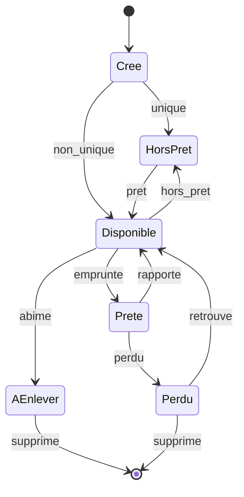
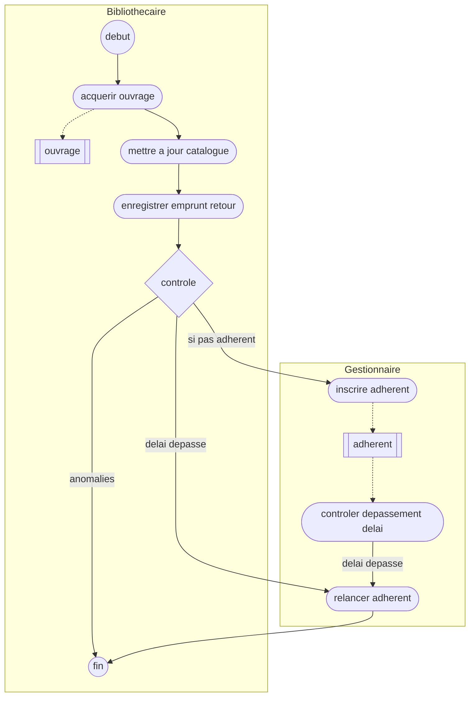
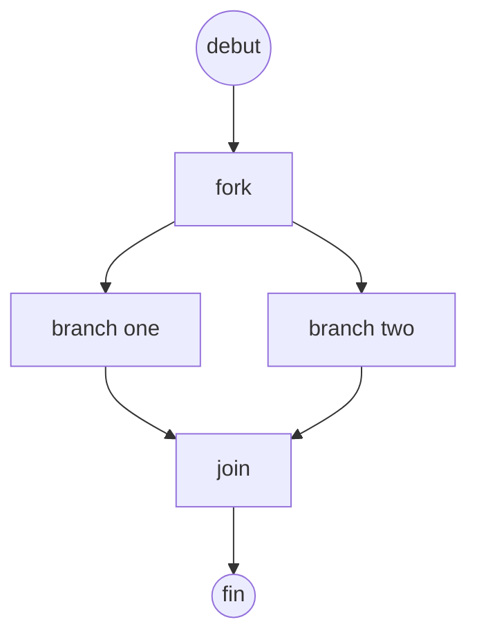

# The StarUML Mermaid dialect — complete reference

Standard Mermaid documentation does **not** describe what StarUML's importer accepts. This document is the observed, verified dialect (against `staruml-mcp` 0.3.x). Anything not listed here should be treated as unverified.

## Supported diagram keywords

`code` must start with exactly one of (case-sensitive):

```
classDiagram  sequenceDiagram  flowchart  erDiagram
mindmap  requirementDiagram  stateDiagram  stateDiagram-v2
```

`activityDiagram` does **not** exist — build activity diagrams with `flowchart`.

Nothing may precede the keyword: no YAML frontmatter (`---`), no comment, no BOM, no blank line, no `title`.

## State machines — the safe form



Hard rules:

1. First line is `stateDiagram-v2`.
2. No `direction LR|TB|RL` directive.
3. ASCII only — strip every accent. `Cree`, `Prete`, `AEnlever`, `HorsPret`. Non-ASCII bytes get corrupted in transport and produce invalid identifiers. (Users can re-accent labels in the StarUML GUI afterward.)
4. **Exactly one colon per transition line.** The parser splits on every `:` in the line. A label `: e1 : cree` breaks tokenization → generation fails.
5. Labels are single identifiers; compose with underscores (`decision_hors_pret`, `after_1an_supprime`, `appuiAvance_incrHeure`).
6. Flat before nested: succeed once with a flat machine before attempting composites.
7. No `%%` comments, `classDef`, `note`, `class` directives.

## Empirical feature matrix

| Feature | Status | Notes |
| ------- | ------ | ----- |
| Flat transitions + labels | ✅ | the bread and butter |
| Self-loops `A --> A : label` | ✅ | |
| Initial/final pseudostates `[*]` | ✅ | one per state machine level |
| Time events as labels (`after_1an_supprime`) | ✅ | plain labels — no special syntax |
| `state "Long Name" as Alias` | ⚠️ parsed | worked in probes; prefer plain ASCII identifiers |
| Labels containing `/`, `()`, `++` | ⚠️ parsed | worked in probes; prefer underscore composition |
| **Second colon in a label** | ❌ hard fail | the #1 breakage |
| `direction` directive | ❌ fail | |
| YAML frontmatter / `title:` | ❌ fail | |
| Nested composites (`state Outer { state Inner { … } }`) | ✅ | arbitrary depth; each composite owns its `[*]` |
| Sibling composites at top level | ✅ | render side by side |
| `%%{init}%%`, themes, `classDef` | ❌ unverified/absent | don't use |

## Activity diagrams via `flowchart`



Verified flowchart features: `subgraph` groups (swimlanes), stadium `([action])`, object `[[object]]`, decision `{...}`, circles `((start/end))`, plain rectangles for fork/join bars, pipe edge labels `-->|guard|`, dotted object-flow arrows `-.->`, edges crossing subgraphs. ASCII everywhere.

## Fork/join pattern



## Failure table (copy for debugging)

| Error message fragment | Cause | Fix |
| ---------------------- | ----- | --- |
| `Failed to execute command(/generate_diagram)` | any parse failure | check the table above; most common: second colon, accents, frontmatter |
| Generation succeeds but diagram is wrong | semantics, not syntax | regenerate with corrected structure (with user consent) |
| Tool call never returns | StarUML closed / API server off | restart StarUML with `apiServer: true` |

## Session hygiene

- Each `generate_diagram` creates a **new** diagram; there is no delete tool.
- Auto-generated names are `"Statechart Diagram by Mermaid"` etc. — keep an ID↔version map (`get_all_diagrams_info` returns them in creation order).
- Verify visually with `get_diagram_image_by_id` after every generation.
- Overlapping labels in exported images are rendering artifacts; structure is truth.
